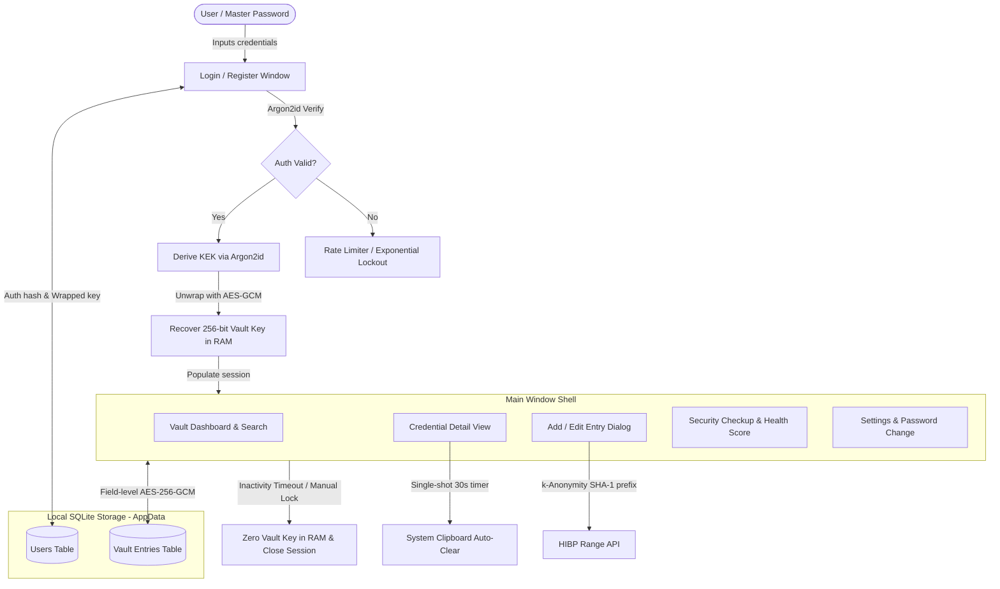
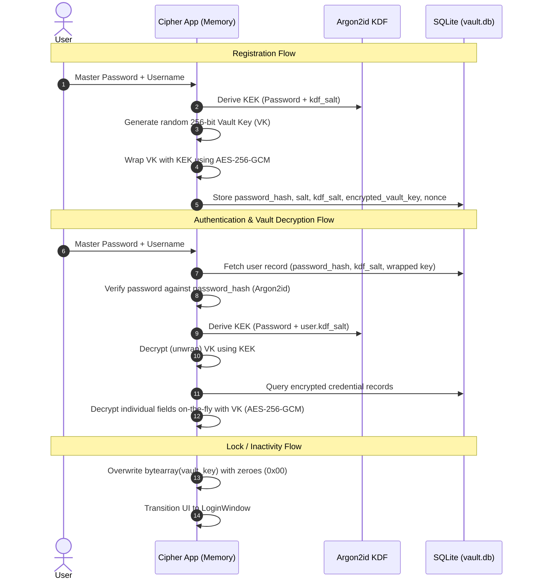

# Cipher — Comprehensive Project Overview

> **Quiet Security** — A minimalist, zero-knowledge desktop password manager engineered for privacy, cryptographic integrity, and visual calm.

---

## 1. Executive Summary

**Cipher** is a modern, privacy-first desktop password manager developed in Python and PyQt6. Designed around the concept of **"Quiet Security,"** it discards cluttered dashboards, aggressive telemetry, and SaaS subscriptions in favor of a local-first, zero-knowledge architecture.

All credentials are cryptographically protected using **AES-256-GCM** authenticated encryption with unique per-field nonces, while master passwords and key derivation are hardened via **Argon2id**. Cipher pairs this security foundation with a sleek monochrome UI, real-time breach detection using the **Have I Been Pwned (HIBP)** k-anonymity protocol, automated clipboard clearing, in-memory key zeroing, and comprehensive security health audits.

---

## 2. Key Features

- **Zero-Knowledge Local Storage**: Data is encrypted locally before touching disk. The master password and unencrypted vault key never leave volatile memory.
- **Argon2id Key Derivation & Hashing**:
  - Independent salts for authentication hashing vs. Key Encryption Key (KEK) derivation.
  - Memory-hard parameters (100 MB RAM, 2 iterations, 8 parallel lanes) mitigate GPU/ASIC brute-force attacks.
- **Cryptographic Key Wrapping**:
  - A dedicated 256-bit AES Vault Key is generated once at registration and stored wrapped (encrypted with the derived KEK) via AES-256-GCM.
- **Field-Level Authenticated Encryption (AES-256-GCM)**:
  - Titles, usernames, passwords, URLs, and notes are individually encrypted.
  - Every field gets an independent, cryptographically secure 12-byte nonce (`secrets.token_bytes(12)`).
  - Built-in 16-byte GCM authentication tags prevent tampering.
- **Real-Time Breach Checking (k-Anonymity)**:
  - Integrates with the Have I Been Pwned (HIBP) API using the 5-character SHA-1 prefix model.
  - The full password hash never leaves the client device.
  - Asynchronous background workers prevent UI freezing, with debounce on keystrokes.
- **Security Checkup Dashboard**:
  - Live Vault Health Score (0–100) with a custom vector arc gauge.
  - Automatic detection of compromised passwords, weak passwords, reused credentials, and stale entries (>90 days untouched).
- **In-Memory Hardening & Auto-Lock**:
  - Application-level inactivity detection across mouse, keyboard, and scroll events.
  - Configurable auto-lock timer (defaults to 300 seconds).
  - Explicit cryptographic zeroing (`vault_key[i] = 0`) of the key array upon lock or exit.
- **Safe Clipboard Operations**:
  - One-click copy for usernames, passwords, and URLs.
  - Single-shot 30-second timer automatically wipes clipboard contents to safeguard against background clipboard sniffers.
- **Built-in Entropy & Password Generator**:
  - Live entropy calculation (bits) with pattern detection (repetition, sequences, dictionary patterns).
  - Customizable generator (variable length, uppercase, lowercase, numbers, symbols).
- **Categorization & Organization**:
  - Filter by Logins, Payment Cards, Secure Notes, and Identities.
  - Mark entries as Favorites or view Recently Used items.

---

## 3. System Architecture & Cryptography

### 3.1 Architectural Overview



### 3.2 Cryptographic Key Hierarchy



### 3.3 Cryptographic Specifications

| Component | Primitive / Algorithm | Parameters / Standard | Purpose |
| :--- | :--- | :--- | :--- |
| **Authentication Hashing** | Argon2id (`argon2-cffi`) | `time_cost=2`, `memory_cost=102400` (100MB), `parallelism=8` | Verify master password without exposing KDF key |
| **Key Derivation (KDF)** | Argon2id raw (`hash_secret_raw`) | 32-byte independent KDF salt, 32-byte key output | Derive Key Encryption Key (KEK) |
| **Key Wrapping** | AES-256-GCM (`cryptography`) | 256-bit KEK, 12-byte nonce, 16-byte tag | Encrypt/decrypt Vault Encryption Key |
| **Field Encryption** | AES-256-GCM (`cryptography`) | 256-bit Vault Key, fresh 12-byte nonce per field | Protect `title`, `username`, `password`, `url`, `notes` |
| **Breach Check** | SHA-1 + k-Anonymity | First 5 hex chars sent; remainder matched locally | Privacy-preserving breach lookup against HIBP |
| **Entropy Evaluation** | Shannon-derived character-set entropy | Log2 charset scale, pattern penalty multiplier | Measure credential complexity in real time |

---

## 4. Project Directory Structure

```text
password/
├── .pytest_cache/             # Pytest runtime test cache
├── build/                     # PyInstaller build artifacts
├── dist/                      # Packaged outputs
│   ├── Cipher/                # Standalone portable distribution folder
│   └── installer/             # Inno Setup Windows installer output
├── gui/                       # User Interface layer (PyQt6)
│   ├── __init__.py
│   ├── add_entry_dialog.py    # Modal for adding & editing credentials with password generator
│   ├── detail_view.py         # Full credential view, field copy actions, auto-clear
│   ├── login_window.py        # Authentication & registration dialogs with rate limiting
│   ├── main_window.py         # App shell, sidebar navigation, top bar, auto-lock watcher
│   ├── security_widget.py     # Security checkup, health score gauge, bulk breach audit
│   ├── settings_widget.py     # Preferences, auto-lock duration, master password change
│   ├── sliding_stack.py       # Custom QStackedWidget with animated horizontal page sliding
│   ├── theme.py               # "Quiet Security" Design System, dark palettes, QSS stylesheet
│   └── vault_widget.py        # Vault dashboard, search bar, and credential list rows
├── models/                    # Data access and SQLAlchemy schema
│   ├── __init__.py            # SQLAlchemy engine, session maker, and schema migrations
│   ├── user.py                # User account schema, salts, and wrapped vault key
│   └── vault.py               # VaultEntry schema, encrypted fields, nonces, and metadata
├── services/                  # Business logic and external service integrations
│   ├── breach_check.py        # Have I Been Pwned (HIBP) k-anonymity API client & QThread worker
│   ├── crypto.py              # Cryptographic primitives: Argon2id, AES-256-GCM, wrapping
│   └── password_generator.py  # Entropy calculation, pattern analysis, secure random generation
├── tests/                     # Unit and integration test suite
│   ├── __init__.py
│   ├── conftest.py            # Isolated in-memory SQLite fixture
│   ├── test_breach_check.py   # Tests for k-anonymity prefix matching and network fallbacks
│   ├── test_crypto.py         # Security tests: nonce uniqueness, tag validation, KEK derivation
│   └── test_models.py         # Model persistence and multi-user isolation tests
├── Cipher.spec                # PyInstaller packaging specification
├── config.py                  # Environment paths (%LOCALAPPDATA%), Argon2 config, preferences
├── installer.iss              # Inno Setup script for building Windows installer (.exe)
├── main.py                    # Application bootstrap and lifecycle controller
├── requirements.txt           # Python package dependencies
└── vault.db                   # Local SQLite development database (auto-migrates to AppData)
```

---

## 5. Detailed Component Breakdown

### 5.1 Application Core (`main.py` & `config.py`)
- **`main.py`**: Initializes the `QApplication`, configures the Fusion style and custom QSS, initializes SQLite database schemas, and orchestrates transitions between the `LoginWindow` and `MainWindow`.
- **`config.py`**: Resolves `%LOCALAPPDATA%\Cipher` to prevent write permission issues when installed in `C:\Program Files`. Automatically migrates any legacy `vault.db` from the project root to AppData. Houses configuration settings (`ARGON2_TIME_COST`, `ARGON2_MEMORY_COST`, `ARGON2_PARALLELISM`, `VAULT_LOCK_SECONDS`).

### 5.2 Cryptography Service (`services/crypto.py`)
- **Authentication**: `hash_password(password)` and `verify_password(hash, password)` use Argon2id with managed salt.
- **Key Derivation (KDF)**: `derive_kek(master_password, kdf_salt_b64)` uses Argon2id raw hashing to derive a 32-byte key.
- **Key Wrapping**: `wrap_vault_key(vault_key, kek)` and `unwrap_vault_key(enc_vk, nonce, kek)` encrypt/decrypt the random 256-bit Vault Key with AES-GCM.
- **Data Protection**: `encrypt_data(plaintext, key)` and `decrypt_data(ciphertext, nonce, key)` generate 12-byte nonces and return base64 ciphertext with authentication tags.

### 5.3 Breach Detection Service (`services/breach_check.py`)
- **`check_password_breach(password)`**: Hashes the candidate password with SHA-1, extracts the first 5 characters, requests candidate suffixes from `api.pwnedpasswords.com/range/{prefix}`, and checks the remaining 35 characters locally.
- **`BreachCheckWorker` & `BreachChecker`**: Manages asynchronous, non-blocking execution via `QThread` and Qt signals, allowing cancellation and restart as the user types.

### 5.4 Password Generator & Entropy Engine (`services/password_generator.py`)
- **`calculate_password_strength(password)`**: Computes mathematical entropy ($E = L \times \log_2(N)$) based on character diversity (lowercase, uppercase, digits, symbols).
- **Pattern Detection**: Penalizes repeated characters and common dictionary substrings (`12345`, `qwerty`, `letmein`, `password`, etc.).
- Returns numerical score (0–100), descriptive label (*Weak*, *Fair*, *Good*, *Strong*, *Very Strong*), and detected warnings.

### 5.5 Database Models (`models/`)
- **`User` (`models/user.py`)**: Stores user identity, Argon2id authentication hash, dual salts (`salt`, `kdf_salt`), and the wrapped Vault Key (`encrypted_vault_key`, `vault_key_nonce`).
- **`VaultEntry` (`models/vault.py`)**: Stores encrypted fields and their corresponding nonces (`encrypted_title`, `encrypted_username`, `encrypted_password`, `encrypted_url`, `encrypted_notes`). Includes organization metadata: `category` (`login`, `card`, `note`, `identity`), `is_favorite`, `last_used_at`, and timestamps.
- **`models/__init__.py`**: Contains `_migrate_vault_entries()`, an idempotent schema migrator that automatically adds missing columns without data loss.

### 5.6 User Interface (`gui/`)
- **`theme.py`**: Implementation of the "Quiet Security" design system. Features an OLED-ready dark gradient background, high-contrast typography, electric blue accents (`#2D7FF9`), semantic status colors (green `#30A46C`, amber `#E5A63E`, red `#E5484D`), and rounded input/button widgets.
- **`login_window.py`**: Centered card with fade-in opacity animation. Supports vault creation and unlocking. Incorporates a brute-force rate limiter that locks out attempts after 5 consecutive failures.
- **`main_window.py`**: Shell containing a 220px navigation sidebar, breadcrumbs/search header, and content stack. Attaches an `InactivityFilter` to `QApplication` to catch any user interaction and restart the auto-lock timer. Fades out window opacity on lock.
- **`vault_widget.py`**: Shows greeting, quick search, item counts, and a scrollable list of `CredentialRow` elements with colored password health indicators.
- **`detail_view.py`**: Displays decrypted fields with copy buttons, password reveal toggle, strength badges, and a 30-second clipboard clearing timer.
- **`add_entry_dialog.py`**: Modal for creating/updating credentials. Includes live entropy visualization, debounced HIBP breach checking, category selection, and an expandable password generation panel.
- **`security_widget.py`**: Vault security dashboard featuring a vector-drawn circular score gauge, counts of vulnerable passwords, and an asynchronous bulk HIBP audit runner.
- **`settings_widget.py`**: User preference manager for changing master passwords and updating auto-lock timeouts.
- **`sliding_stack.py`**: Reusable `QStackedWidget` subclass providing horizontal sliding page transitions with easing curves.

---

## 6. Security Model & Threat Mitigation

| Threat Vector | Mitigation in Cipher |
| :--- | :--- |
| **Disk Forensics / Database Theft** | SQLite database contains zero plaintext credentials. All fields are encrypted with AES-256-GCM. The Vault Key is wrapped with Argon2id-derived KEK. |
| **GPU / ASIC Dictionary Attacks** | Argon2id is configured with 100 MB memory cost and multiple iterations, drastically raising hardware costs for offline cracking. |
| **Replay / Nonce Collision** | Cryptographically secure 12-byte random nonces generated per field write via `secrets.token_bytes(12)`. Nonces are never reused. |
| **Ciphertext Tampering** | AES-GCM includes 16-byte authentication tags. Any modification to ciphertext or nonce raises `cryptography.exceptions.InvalidTag`. |
| **RAM Snooping on Inactive Machine** | Global event filter monitors activity. After inactivity timeout, the vault key `bytearray` is explicitly zeroed out in memory before returning to the lock screen. |
| **Network Interception of Passwords** | Local-first design. The only outbound connection is to the HIBP range API using k-anonymity (first 5 chars of SHA-1 only). Full passwords never touch the network. |
| **Clipboard Snooping** | When copying credentials, an internal single-shot timer automatically empties the OS clipboard after 30 seconds. |
| **Brute Force on Master Password** | In-memory rate limiter enforces exponential backoff after 5 failed authentication attempts. |

---

## 7. Installation & Development Setup

### 7.1 Prerequisites
- **Python 3.10+** (64-bit recommended)
- **Git**
- **Inno Setup 6** (optional, for creating the Windows installer executable)

### 7.2 Environment Setup

1. **Clone the repository**:
   ```bash
   git clone https://github.com/your-username/cipher.git
   cd cipher
   ```

2. **Create and activate a virtual environment**:
   ```powershell
   # Windows PowerShell
   python -m venv venv
   .\venv\Scripts\Activate.ps1
   ```

3. **Install dependencies**:
   ```bash
   pip install -r requirements.txt
   ```

4. **Run the application**:
   ```bash
   python main.py
   ```

---

## 8. Testing & Quality Assurance

The project includes unit and integration tests written for `pytest`:

```bash
# Run the complete test suite
pytest -v

# Run only cryptographic security tests
pytest tests/test_crypto.py -v

# Run breach check tests
pytest tests/test_breach_check.py -v

# Run model and database tests
pytest tests/test_models.py -v
```

### Coverage Highlights:
- **`test_crypto.py`**: Verifies password hashing, KEK derivation determinism, key wrapping round-trips, AES-GCM nonce randomness, tamper-resistance (tag verification), and empty-string handling.
- **`test_breach_check.py`**: Tests HIBP range query formatting, 5-character prefix isolation, known compromised password matching, and graceful failure on network drops.
- **`test_models.py`**: Tests user creation, credential persistence, field-level encryption round-trip with SQLite, and multi-user tenant isolation.

---

## 9. Build and Distribution

### 9.1 Standalone Executable (PyInstaller)

To compile the application into a standalone folder:
```bash
pyinstaller Cipher.spec
```
The compiled application will be generated in `dist/Cipher/Cipher.exe`.

### 9.2 Windows Installer (Inno Setup)

The project includes an Inno Setup script (`installer.iss`) configured for 64-bit Windows installations:
- Target directory: `%ProgramFiles%\Cipher`
- Database location: `%LOCALAPPDATA%\Cipher\vault.db` (ensures write access without admin rights)
- Creates Desktop and Start Menu shortcuts.
- Includes clean uninstallation hooks.

To build the setup installer:
1. Open `installer.iss` in the Inno Setup Compiler.
2. Click **Build > Compile** (or use `iscc installer.iss` from the command line).
3. The resulting installer will be located in `dist/installer/Cipher_Setup_v1.0.exe`.

---

## 10. Google Chrome Extension & Native Messaging (Manifest V3)

Cipher includes a dedicated **Google Chrome Extension** built on **Manifest V3** for seamless autofill and automatic credential capture:

### 10.1 Architecture & Components
- **Deterministic Key / ID**: Uses an embedded RSA public key to ensure Chrome deterministically assigns the ID `dhmkinmiippfgmcdllobdhkkfccpkaan`.
- **Service Worker (`background.js`)**: Communicates with the desktop vault via standard length-prefixed JSON stdio native messaging (`com.cipher.password_manager`).
- **In-Page Floating Banner (`content/autofill.js`)**: Style-isolated Shadow DOM banner for one-click credential saving upon login/registration submissions, with `sessionStorage` buffering to survive immediate redirects.
- **Extension Popup (`popup/`)**: Quick-fill matching credentials, vault search, one-click copy, and integrated password generation.
- **Native Host Installer (`extension/native-host/install_native_host.py`)**: Automatically registers Chrome NativeMessagingHosts in `HKCU\Software\Google\Chrome\NativeMessagingHosts\com.cipher.password_manager`.

---

## 11. Summary Matrix

| Attribute | Specification |
| :--- | :--- |
| **Application Type** | Desktop GUI (PyQt6 Fusion) + Browser Extension (Chrome MV3) |
| **Target Platform** | Windows 10 / 11 (Cross-platform compatible core) |
| **Browser Support** | Google Chrome (Manifest V3) |
| **Language** | Python 3.10+ (Desktop & Native Host) / Modern Vanilla JavaScript (Extension) |
| **Cryptography** | AES-256-GCM, Argon2id, SHA-1 (k-Anonymity) |
| **Database** | SQLite via SQLAlchemy 2.0 |
| **Network Activity** | Zero-knowledge; optional k-anonymity HIBP API lookup only |
| **Licensing / Model** | Local-first, standalone, open-source capable |

